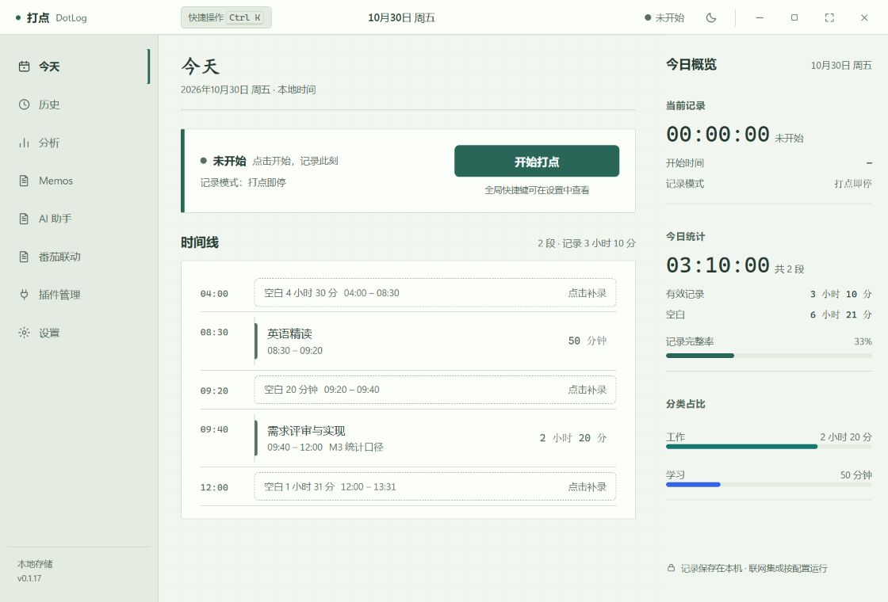
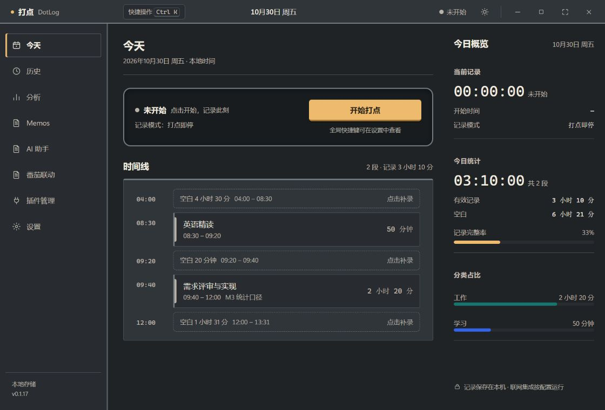

# 打点 DotLog

一个本地优先的桌面时间记录应用。按下「打点」开始计时，段关闭后可自动发布到自托管 Memos，并支持番茄Todo 数据导入对比与智能分析。

> **免责声明**
> 本项目代码由 AI 辅助生成，目前**未经过完整的稳定性测试**。请在注意数据安全的前提下使用：
>
> - 重要数据请定期通过应用内「设置 → 备份」功能导出备份
> - 作者不对因使用本软件造成的任何数据丢失或损失承担责任
> - 遇到问题欢迎提 Issue，但请自行评估是否适合用于关键场景

## 当前版本 · v0.1.17

[下载 Windows 正式安装包](https://github.com/walker42144/dotlog/releases/tag/v0.1.17) · [更新与审查报告](docs/release-0.1.17.md)

- 番茄联动以独立 JSON 插件安装、启停或移除。内置观察器负责本机连接，不需要外部脚本；支持同标题分段、备注补记、任务结束收尾与历史增量导入。首次安装插件后需单独启用。
- AI 助手提供按日期整理记录、逐条编辑采纳、日/周复盘、围绕记录提问及 Markdown 导出，遵循已配置的隐私模式。
- 新增方格手账、翻页档案、仪表台和轻透浮层四套主题，以及操作反馈动画和减少动态效果设置。
- 保留本地计时、备份恢复校验、Memos Access Token 客户端、Markdown/公式排版和快捷操作。

本地插件支持权限预览、同 ID 替换更新、可选侧边栏及独立页面。隐藏入口不会停用插件，停用或移除才停止后台联动；存在活动分段时会提示先结束该段。

- [本地插件规范](docs/local-plugin-guide.md)
- [番茄联动插件源码](examples/plugins/tomatodo-link)
- [内置观察器说明](docs/tomatodo-native-observer.md)
- [AI 工作台说明](docs/ai-workbench.md)

| 方格手账 | 仪表台 |
|---|---|
|  |  |

本轮通过 280 项 Rust 测试、16 项前端测试、严格 Clippy 与正式打包。浏览器截图使用模拟数据，不能替代安装后的 WebView2、真实 AI/Memos 服务或长期运行验收；依赖告警和兼容性限制见审查报告。外部插件通过受限宿主接口获取能力，不提供任意文件、SQL、进程或通用 MCP 执行权限。

## 功能

- **打点计时**：一键开始/打卡/暂停/结束，支持事后补录、编辑、拆分、合并时间段
- **今日时间线**：可视化当天所有记录段，空隙一键补录
- **历史与统计**：按天浏览历史记录，分类统计与趋势分析
- **Memos 集成**：段关闭后自动发布为 Memos 笔记（支持可见性、备注、标签规则），使用插件 Access Token 在应用内浏览、编辑笔记
- **番茄Todo 集成**：扫描本地番茄Todo 数据，与 DotLog 记录对比覆盖率，生成智能分析建议
- **AI 助手**（可选）：接入 OpenAI 兼容接口，辅助标题/标签建议与数据分析
- **数据本地存储**：SQLite 本地数据库，令牌存系统钥匙串；启用联网集成时按配置向指定服务发送授权内容

## 技术栈

- **桌面框架**：Tauri 2（Rust + WebView2）
- **前端**：React 19 + TypeScript + Vite，原生 CSS 主题与材质样式（支持跟随系统及减少动态效果）
- **后端**：Rust workspace（domain / application / storage / plugin-sdk / plugin-host / memos / ai / tomatodo）
- **插件体系**：内置 Rust 集成 + 可本地安装的 UI Worker 插件，支持权限声明、独立页面、可选侧边栏和隔离的数据存储

## 安装与运行

### 使用安装包（Windows）

从 [Releases](../../releases) 下载 `DotLog_x.x.x_x64-setup.exe`，双击安装即可。

> 依赖 WebView2 Runtime（Windows 10 21H2+ / Windows 11 通常已预装）。

### 从源码构建

前置条件：Rust（stable）、Node.js 20+、Tauri 2 系统依赖（见 [Tauri 官方文档](https://v2.tauri.app/start/prerequisites/)）。

```powershell
# 安装依赖
npm install
cd apps/desktop; npm install; cd ../..

# 开发模式（热更新）
cd apps/desktop
npm run tauri dev

# 打包 Windows 安装包（NSIS）
npm run tauri build -- --bundles nsis
```

产物位于 `target/release/bundle/nsis/`。

### 测试与检查

```powershell
cargo test --workspace          # Rust 测试
cargo clippy --workspace --all-targets   # Rust 静态检查
cd apps/desktop; npx tsc --noEmit        # 前端类型检查
```

## Memos 集成配置

1. 打开「集成」页，启用 **Memos 发布**
2. 填写实例地址（如 `https://memos.example.com`）和访问令牌（Memos 后台 → 设置 → Access Tokens）
3. 点「保存」，再点「测试连接」
4. 「自动发布」选择「段关闭时自动发布」
5. 侧边栏点击「Memos」可在应用内直接浏览你的 Memos 页面

## 项目结构

```
dotlog/
├── apps/desktop/        # Tauri 桌面端（React 前端 + Rust 主进程）
├── crates/
│   ├── domain/          # 领域模型与计时状态机
│   ├── application/     # 应用服务层
│   ├── storage/         # SQLite 存储与迁移
│   ├── plugin-sdk/      # 插件契约 SDK
│   ├── plugin-host/     # 插件宿主（能力裁决、网络白名单、钥匙串）
│   ├── memos/           # Memos 集成插件
│   ├── ai/              # AI 助手插件
│   └── tomatodo/        # 番茄Todo 数据导入与对比
└── docs/                # 架构、数据字典、插件 SDK 等设计文档
```

## License

MIT
