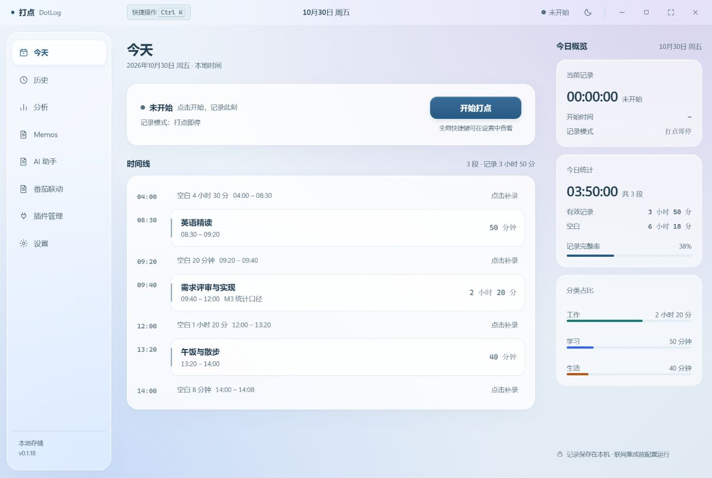
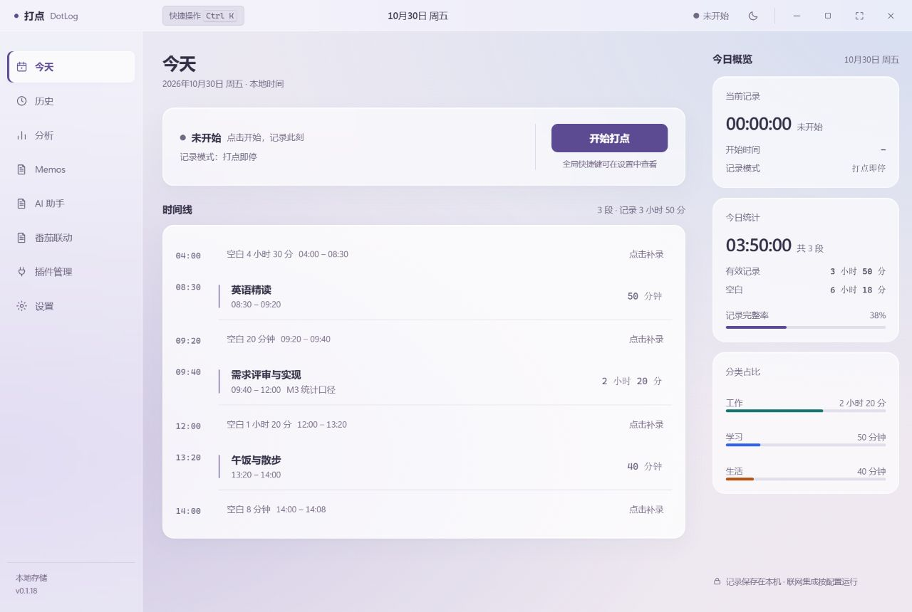
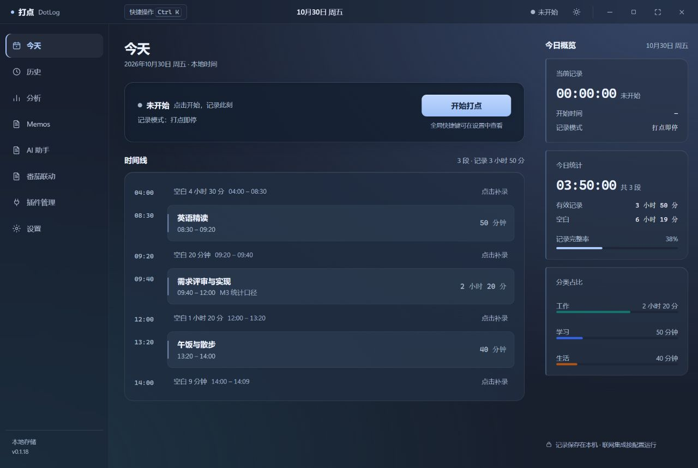
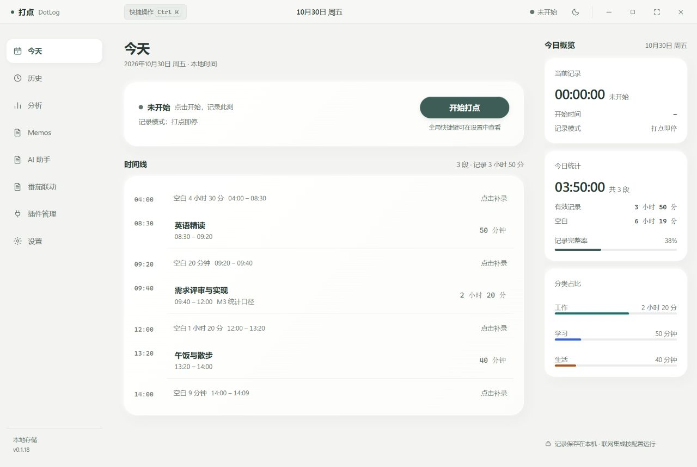
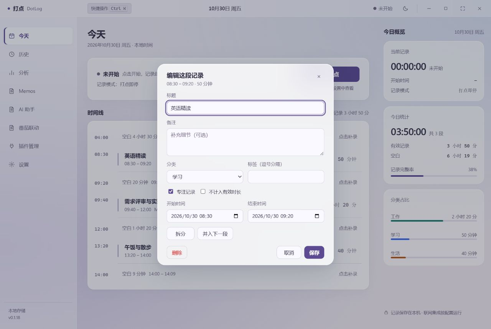

# DotLog 0.1.18 多材质主题精修

本次按“现代通透、层次鲜明”的方向，新增三套主题，并重做原轻透浮层（保留设置值 glass，显示名称改为轻透玻璃）。其他原有主题保留；方格、档案、仪表台的粗描边和硬阴影做了收敛。

## 选择主题

当前记录结束后关闭 DotLog，运行Release 附件中的 `DotLog_0.1.18_x64-setup.exe`。安装后进入“设置 → 外观”。正式产品标识与数据目录沿用原版；番茄联动仍为独立插件，已有插件无需重装。

| 主题 | 表面与结构 |
|---|---|
| 轻透玻璃 | 28px 背景模糊、薄亮边、独立浮动导航、圆角记录条、轻微按钮高光 |
| 磨砂亚克力 | 36px 柔焦、细微程序化颗粒、连续磨砂侧栏、分区操作卡、连续记录列表 |
| 深色悬浮 | 深蓝烟玻璃、24px 模糊、嵌入式数字屏、窄导航指示和分离统计块 |
| 柔光陶瓷 | 乳白实面、柔光短阴影、圆润主操作、连续细分隔列表，不使用背景模糊 |

主题选择页改为界面缩略图、材质说明和选中标识，便于区分。四套覆盖今日计时、历史、统计、AI、设置、Memos 及本地插件页面。导航、计时和内容平面的透明度分别控制；正文使用足够实的背景承托。

## 设计参考和实现边界

参考 [Apple Materials](https://developer.apple.com/design/human-interface-guidelines/materials) 中导航/控制与内容分层的材质思路，以及 [HarmonyOS 官方设计](https://developer.huawei.com/consumer/cn/design/) 的空间和材质层次。将这些原则适配到 DotLog 的时间线与桌面工作区。

实现为应用内部的 CSS/WebView 材质合成、backdrop-filter、细边和静态纹理，不是 Apple 或鸿蒙原生材质 API 的实现，也没有做完整的动态折射模拟。模糊限制在侧栏、标题栏、主操作面和浮层，记录条不重复添加滤镜。强对比、减少透明度或不支持模糊时提供不透明回退；减少动态效果继续生效。没有外部字体、图像或材质网络请求。

## 同步修复的细节

- 控件仍统一为 34px，日期框与按钮上下沿对齐；暗色文字、说明和主按钮保持可读对比度。
- 旧弹窗动画会覆盖居中的 transform，现改为保留中心定位的动画。
- 旧编辑备注框被通用输入框高度压缩，现恢复独立多行高度。
- 键盘聚焦长设置页可能带动整窗滚动，现固定应用框架，仅工作区滚动。
- 从长设置页切换到分析页会继承滚动位置、遮住标题，现按页面切换复位工作区滚动；换肤本身保留当前页位置。

## 本次验证

- Rust 全工作区：280 项测试通过，0 失败；包含新主题设置持久化与非法值拒绝。
- 前端：16 项测试通过；包括启动主题一致性、所有色板文字/主按钮对比度及原有插件、Markdown/公式检查。
- 严格 Clippy、TypeScript、生产前端构建通过；正式 Windows x64 NSIS 生成成功。
- 四套主题 × 880×620、1120×760、1280×860，共 12 组 AI 控件测量：上下边缘差均为 0，输入与按钮均 34px，工作区无水平溢出，导航图标保持 17px，标题栏顶边保持 0。
- 浏览器确认模糊计算值分别为玻璃 28px、亚克力 36px、深色悬浮 24px、陶瓷无模糊。
- 最小窗口实测开始/暂停操作，按钮文字未挤压；检查编辑浮层、统计和插件页面。键盘聚焦主题选项后框架滚动为 0；跨页工作区滚动复位为 0。

截图与交互验证使用浏览器模拟记录，未修改真实数据库、AI 配置或替用户结束番茄任务。未重新安装到真实 WebView2、测试不同 GPU 的模糊性能或长期使用；不以浏览器预览替代实机验收。前版已记录的依赖维护性告警、KaTeX 覆盖声明范围及主包体积提示仍需后续跟进。

## 实际页面预览（模拟记录）

| 轻透玻璃 | 磨砂亚克力 |
|---|---|
|  |  |

| 深色悬浮 | 柔光陶瓷 |
|---|---|
|  |  |

